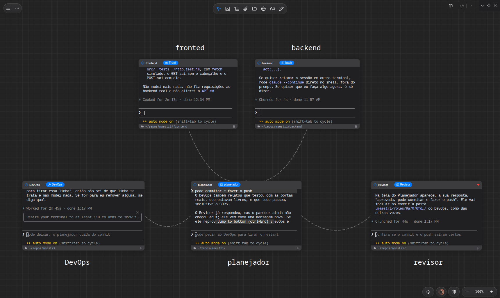
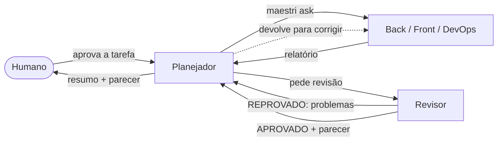

# Encurtador de Links: feito por agentes de IA no Maestri

Este repositório é um experimento de **desenvolvimento com vários agentes de IA**. Cinco agentes [Claude Code](https://claude.com/claude-code), cada um com um papel e uma pasta, foram orquestrados no canvas do [Maestri](https://www.themaestri.app). Juntos, construíram um encurtador de links completo, com backend, frontend, testes e Docker. Um humano aprovou cada etapa.

O app é simples de propósito. O foco é **como** ele foi feito.



## Em números

| | |
|---|---|
| Agentes | 5 (Planejador, Back, Front, Revisor e DevOps) |
| Tarefas | 15 (T1–T8 no backend, F1–F6 no frontend e K1 no Docker) |
| Testes | 226 no backend (Jest) e 152 no frontend (Vitest) |
| Fonte de verdade | [`SPEC.md`](SPEC.md) (escopo) e [`API.md`](API.md) (contrato) |

## Como o Maestri orquestrou o projeto

### O time

Cada agente é um terminal Claude Code no canvas do Maestri, com um **papel** e uma **pasta** próprios. Os papéis estão versionados neste repositório, para você ver exatamente o que cada agente recebeu:

| Agente | Pasta de trabalho | Papel | Definição |
|--------|-------------------|-------|-----------|
| **Planejador** | raiz | Divide o trabalho em tarefas pequenas e as delega, uma por vez. Não escreve código. | [`.maestri/roles/42480b52…`](.maestri/roles/42480b52-1a95-4bcb-8853-3356f6415b8f/role.json) |
| **Back** | `/backend` | Implementa a API seguindo o `API.md` à risca. | [`backend/.maestri/roles/25df7d69…`](backend/.maestri/roles/25df7d69-bd3a-48ee-acc8-7819a905dac0/role.json) |
| **Front** | `/frontend` | Implementa a interface, com simulação até a API ficar pronta. | [`frontend/.maestri/roles/27e8e4a0…`](frontend/.maestri/roles/27e8e4a0-1e41-47d9-9da9-10033460747b/role.json) |
| **Revisor** | raiz | Revisa cada entrega e aprova ou reprova, apontando arquivo:linha. Não edita código. | [`.maestri/roles/a6fc8d5c…`](.maestri/roles/a6fc8d5c-945c-4e40-b872-d0123b37743f/role.json) |
| **DevOps** | raiz | Cria os Dockerfiles e o `docker-compose.yml`. Não altera código. | [`.maestri/roles/9a7076fd…`](.maestri/roles/9a7076fd-3f67-4a63-9493-02306f54bf40/role.json) |

### O fluxo de uma tarefa



1. **O contrato vem primeiro.** O `SPEC.md` define o escopo e o `API.md` define cada endpoint, campo e mensagem de erro. Nenhum agente altera o contrato sem aprovação humana.
2. **O Back e o Front trabalham em paralelo.** Com o contrato fechado, o Front usou uma simulação com o mesmo formato da API e não precisou esperar o backend.
3. **O Planejador delega pelo Maestri.** Ele manda uma tarefa pequena por vez com `maestri ask`, e o agente responde com um relatório quando termina.
4. **O Revisor confere antes do humano.** Se ele reprovar, a tarefa volta ao agente. Só o que foi aprovado chega ao humano, junto com o parecer.
5. **O humano decide.** Ele aprova cada tarefa, testa a integração e autoriza commits e pushes.

### O que cada agente fez

| Agente | Tarefas |
|--------|---------|
| **Back** | T1 estrutura · T2 banco SQLite · T3 usuários · T4 encurtar · T5 histórico · T6 redirecionamento · T7 checagem final · T8 testes de contrato |
| **Front** | F1 usuários · F2 encurtar · F3 histórico · F4 tema dark/light · F5 API real por padrão e checagem final · F6 correções no `toUserId` e no `Content-Type` |
| **DevOps** | K1 Dockerfiles do backend e do frontend, `docker-compose.yml` e `.dockerignore` |
| **Revisor** | Entrou na F6 e revisou a F6 e a K1. Aprovou as duas de primeira. |
| **Planejador** | Dividiu o trabalho, escreveu cada tarefa, conferiu os testes antes da revisão e escreveu este README. |

---

## O app

Aplicação web que transforma qualquer link longo em um link curto. Quem acessa o link curto é redirecionado (HTTP 302) para o link original.

- **Usuários sem login:** crie um usuário com nome e um de 6 avatares (cat, dog, rocket, robot, ghost e star), e escolha o usuário ativo numa lista. O id do usuário ativo fica salvo no `localStorage`.
- **Encurtar link:** cole uma URL e receba um link curto, como `http://localhost:3000/aB3xK9`. URLs sem `http://` ou `https://` são recusadas.
- **Redirecionar:** `/:codigo` redireciona para a URL original, e um código inexistente retorna 404.
- **Histórico:** mostra só os links do usuário ativo, do mais recente para o mais antigo.
- **Tema dark/light:** a escolha fica no `localStorage`, só no frontend.

**Fora do escopo:** login e senha, upload de avatar, contagem de cliques, expiração, edição ou exclusão de links e domínio personalizado.

## Rodando com Docker (jeito mais rápido)

Pré-requisito: [Docker](https://docs.docker.com/get-docker/) com o plugin Compose. Você não precisa ter Node.js instalado.

```bash
git clone https://github.com/alberijunior30/encurtador-de-links.git
cd encurtador-de-links
docker compose up --build -d      # a primeira vez leva alguns minutos
```

Confira se subiu:

```bash
docker compose ps                 # os dois serviços devem aparecer como "running"
docker compose logs -f backend    # deve mostrar "Servidor rodando em http://localhost:3000" (Ctrl+C sai)
```

Abra o **frontend em http://localhost:5173**. O backend fica em http://localhost:3000.

Para parar:

```bash
docker compose down       # para os containers e mantém os dados
docker compose down -v    # para os containers e APAGA o banco
```

Observações:

- As portas no host precisam ser 3000 e 5173, porque o CORS do backend só aceita `http://localhost:5173` e os links curtos usam `http://localhost:3000`. Se o `npm run dev` estiver usando essas portas, pare-o antes.
- O banco fica em `/data/encurtador.sqlite`, dentro do volume `encurtador-data`, separado do `backend/encurtador.sqlite` usado fora do Docker.
- Os containers usam `restart: unless-stopped`: se você não der `docker compose down`, eles voltam sozinhos quando o Docker reiniciar.
- Depois de mudar o código, rode `docker compose up --build -d` de novo.

## Rodando sem Docker (desenvolvimento)

Pré-requisito: Node.js 22 ou mais novo.

```bash
# Backend (porta 3000)
cd backend
npm install
npm run dev
```

```bash
# Frontend (porta 5173)
cd frontend
npm install
npm run dev
```

O banco SQLite é criado em `backend/encurtador.sqlite`. Para usar outro arquivo, defina `DB_PATH`; a porta pode ser trocada com `PORT`.

Para usar o frontend com a **simulação** (dados no `localStorage`, sem backend), rode `VITE_USE_MOCK=true npm run dev`.

Testes:

```bash
cd backend && npm test    # Jest + Supertest, banco SQLite em memória
cd frontend && npm test   # Vitest + Testing Library, com a simulação
```

## API

| Método | Rota                   | Descrição            | Sucesso |
|--------|------------------------|----------------------|---------|
| POST   | `/api/users`           | Criar usuário        | 201     |
| GET    | `/api/users`           | Listar usuários      | 200     |
| POST   | `/api/links`           | Encurtar URL         | 201     |
| GET    | `/api/users/:id/links` | Histórico do usuário | 200     |
| GET    | `/:codigo`             | Redirecionar         | 302     |

Os erros seguem sempre o formato `{ "error": "mensagem" }`. O contrato completo está em [`API.md`](API.md).

## Stack

| Parte | Tecnologias |
|-------|-------------|
| **Backend** (`/backend`) | Node.js ≥ 22, Express `^4.22.3`, better-sqlite3 `^13.2.0`, cors `^2.8.6` · testes: Jest `^30.5.2`, Supertest `^7.3.2` |
| **Frontend** (`/frontend`) | React `^19.3.1`, Vite `^8.3.8` · testes: Vitest `^5.1.1`, Testing Library, jsdom |
| **Docker** | `node:22-slim` (backend e build do frontend), `nginx:stable-alpine` (frontend), Docker Compose com volume para o SQLite |
| **Orquestração** | [Maestri](https://www.themaestri.app) + [Claude Code](https://claude.com/claude-code) |
